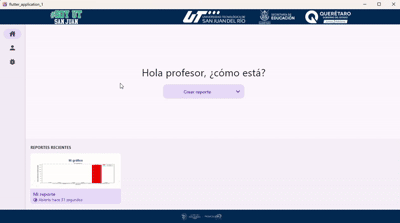

# UT Report Generator


Esta es una aplicación interna de la UTSJR cuyo objetivo final es automatizar la generación de reportes del desempeño
de los grupos que Secretaría Académica a los tutores de grupo.

Se trata de un proyecto desarrollado en conjunto por Edgar Trejo Avila y el profesor [Gregorio Rodríguez Miranda](https://github.com/GoyoRodMir), con la mentoría de la doctora Brenda Juárez Santiago.



## Tecnologías Utilizadas

* **Dart** como marco de trabajo para desarrollar el frontend
* **Matplotlib** y **Pandas** para la manipulación de datos y generación de gráficos
* **python-pptx** para la generación de archivos de PowerPoint
* **Flask** como marco de trabajo para desarrollar el backend

## Ejecución en Modo Desarrollo

1. Configurar variables de entorno
```sh
# Archivo .env
RUNNING_MODE=development
IS_TESTING_MODE=false
```

2. Ejecutar el servidor de Python
```sh
cd python-app
./venv/Scripts/Activate.ps1
python main.py
```

3. Ejecutar la aplicación de Flutter en Windows
```sh
# Desde la carpeta raíz del proyecto
flutter run -d windows
```

## Compilación

### Windows

**Requisitos Previos**
* Python 3.10 o superior
* PyInstaller instalado 
* InnoSetup (versión 6 o superior) instalado y en el PATH del sistema

**Pasos a Seguir**
1. Compilar el programa de Python usando PyInstaller
```sh
cd python-app
pyinstaller --onefile main.py
```

2. Compilar el programa de Flutter
```sh
# Desde la carpeta raíz del proyecto
flutter build windows --release
```

3. Compilar el script de InnoSetup
```sh
# Desde la carpeta raíz del proyecto
iscc compilation-script.iss
```

## Cómo Contribuir al Proyecto


